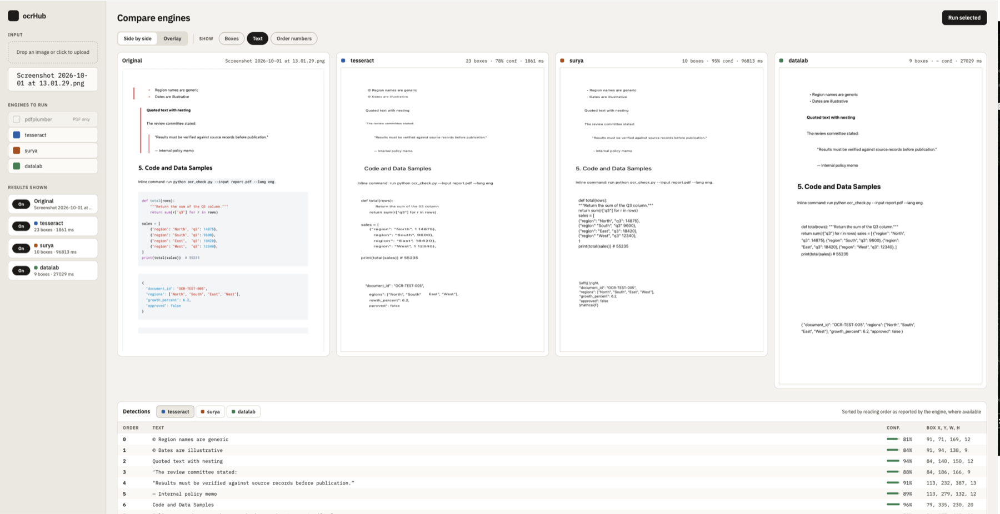

# ocrHub

One Docker image, several OCR engines, one API.

Over many projects I kept asking the same question: which OCR engine is right
for this document, and what will it actually give me? What I learned each time
was scattered. ocrHub gathers that experience in one place and shares it, so
anyone exploring AI automations that involve OCR can see how several engines
handle their own documents, side by side, and decide faster.



**Who it's for.** Anyone choosing or testing OCR for an automation: upload a
document, run several engines on it, and compare their text, boxes, reading
order and tables. A script or an AI agent can call the same engines through the
API or MCP. It runs on CPU in one container, so it's built for comparing, not
for speed: Surya can take minutes per page, and there's no GPU inside the
container.

Want to know what each engine can and can't do? See the
[visualisation guide](docs/visualisations.md).

## Included engines

| Engine | Version | What it gives you | Runs |
|---|---|---|---|
| Tesseract | 5.5.0 (pytesseract 0.3.13) | text, per-word confidence, line boxes | local, always included |
| pdfplumber | 0.11.9 | the text layer of born-digital PDFs: fonts, colours, tables | local, always included |
| Surya | 0.14.7 (models: detection 2025-05-07, recognition 2025-05-16, layout and tables 2025-02-18) | line OCR, layout regions, reading order, tables | local, add with `ENGINES=surya` |
| PaddleOCR | 3.7.0 (paddlepaddle 3.2.2, PP-OCRv6 English models) | line OCR: text, line boxes, per-line confidence; with `PADDLE_LAYOUT=1` also typed regions and Picture crops | local, add with `ENGINES=paddleocr` |
| Datalab | hosted API (`datalab-python-sdk` 0.5.0, mode `accurate`) | layout blocks, html tables, pictures | cloud, add with `ENGINES=datalab` and a `DATALAB_API_KEY` (paid, free monthly tier: [datalab.to](https://www.datalab.to)) |

These are the versions in an image built with all engines. The published image
has only Tesseract and pdfplumber. Surya is pinned to 0.14.7; PaddleOCR needs
3.x (`paddleocr>=3.7,<4`); the others follow
what the image build installs. [docs/visualisations.md](docs/visualisations.md)
explains what each engine returns, how the dashboard draws it, and why newer
Surya releases aren't used yet.

## Quickstart

**Try it without building anything.** The published image has Tesseract and
pdfplumber (about 640 MB, for Intel/AMD and Apple Silicon):

```bash
mkdir -p data
docker run -p 8000:8000 -v "$PWD/data:/home/ocrhub/data" ghcr.io/misky8/ocrhub:latest
```

Open <http://localhost:8000>. Surya, PaddleOCR and Datalab aren't in that image
(Surya alone adds several GB), so to use them build from source as below. Version tags
such as `ghcr.io/misky8/ocrhub:0.1.0` are available too.

**Build it yourself,** from this folder, with Docker running:

```bash
mkdir -p data              # your results are saved here
docker compose up --build
```

Open <http://localhost:8000>. Stop it with `Ctrl+C`.

That builds the smallest image: Tesseract and pdfplumber. To add Surya,
PaddleOCR or Datalab, copy the config template, edit it, and rebuild:

```bash
cp .env.example .env       # set ENGINES=surya,paddleocr,datalab and DATALAB_API_KEY
docker compose up --build
```

- **First build with Surya is slow:** several GB of packages, 15 to 60
  minutes. After that, code-only rebuilds take seconds. Only changing
  `ENGINES` or `pyproject.toml` reinstalls the packages.
- **Surya downloads its models on first use** (about 2 GB, kept in a Docker
  volume so it happens once), so its first run is slow too. PaddleOCR does the
  same with its PP-OCRv6 models.
- **With `surya` in `ENGINES`, the Dockerfile installs the CPU build of torch
  first.** Otherwise PyPI's Linux torch pulls several GB of NVIDIA CUDA
  packages a CPU container can't use.
- `.env` is gitignored, so it's yours. Changing `ENGINES` needs a rebuild;
  other settings (such as `DATALAB_API_KEY`) only need `docker compose up`.

Without Compose:

```bash
docker build --build-arg ENGINES=surya,paddleocr,datalab -t ocrhub .
docker run -p 8000:8000 \
  -e DATALAB_API_KEY=your-key-here \
  -v ocrhub-models:/home/ocrhub/.cache \
  -v "$PWD/data:/home/ocrhub/data" ocrhub
```

(In PowerShell use `${PWD}`, in `cmd` use `%cd%`. The first volume keeps
Surya's models; without it they are downloaded again for every new container.)

To see what the app is doing (engine progress, errors, model downloads), run
`docker compose logs -f ocrhub` in a second terminal.

## Settings (`.env`)

Copy `.env.example` to `.env` and uncomment what you want to change. `.env` is
gitignored; keep `.env.example` listing every variable. Only `ENGINES` changes
what is installed, so only it needs a rebuild (`docker compose up -d --build`).
The rest take effect with `docker compose up -d`. Results are cached by file
content, so after changing a setting that affects output, re-run the file with
`refresh=true` (or delete its `data/output/<hash>/<engine>.json`). The unit tests mock the
models, so they don't check any of these values against real output: when you
change a model setting, run a real file through the container and compare.

| Variable | Default | What it does and when to change it |
|---|---|---|
| `ENGINES` | blank (Tesseract and pdfplumber only) | Optional engines to install: any of `surya`, `paddleocr`, `datalab`, comma-separated. Rebuild after changing. Each adds install time and disk. |
| `DATALAB_API_KEY` | blank (Datalab off) | Enables the hosted Datalab engine. Paid, with a free monthly tier. |
| `DATALAB_MODE` | `accurate` | Datalab's processing mode, passed to its API as is. **Only `accurate` has been tested here;** check any other value against Datalab's docs and your own files. |
| `DATALAB_TIMEOUT` | `600` | Seconds to wait for a Datalab result. Raise it for large files. |
| `DATALAB_BASE_URL` | `https://www.datalab.to` | Only for a self-hosted or proxied Datalab endpoint. |
| `SURYA_RECOGNITION_BATCH_SIZE` | `8` | Lines Surya recognises at once. Lower it if the container is OOM-killed (slower, less memory). |
| `SURYA_DETECTOR_BATCH_SIZE` | `1` | Same trade-off for Surya's detector. |
| `SURYA_LAYOUT` | `1` | `0` skips Surya's layout and table models: plain lines, faster, less memory. |
| `SURYA_LAYOUT_BATCH_SIZE`, `SURYA_TABLE_REC_BATCH_SIZE` | `2` | Batch sizes for those two models. Lower to save memory. |
| `PADDLE_LAYOUT` | `0` | `1` runs a layout model after PaddleOCR's text recognition, giving typed regions (Title, Text, Table, Picture...) and figure crops. Off, PaddleOCR returns plain line boxes with no pictures. |
| `PADDLE_LAYOUT_MODEL` | `PP-DocLayout-S` | Which PaddleOCR layout model to use, any PP-DocLayout name PaddleOCR supports (for example `PP-DocLayout-L`). Larger models may find more figures but are slower and use more memory. Downloads on first use. Only used when `PADDLE_LAYOUT=1`. **Only `PP-DocLayout-S` has been tested here;** try another on your own files first. |
| `PADDLE_LAYOUT_THRESHOLD` | blank (the model's default) | Minimum score, 0 to 1, for a layout region to be kept. Lower it if figures are missed; expect false regions too. Invalid values are logged and ignored. Only used when `PADDLE_LAYOUT=1`. **Only the default has been tested here;** lower values add false regions (see `docs/visualisations.md`). |
| `OCRHUB_DATA_DIR` | `./data` | Folder for uploaded files and cached results (see "Your results"). |

## Using it

**The dashboard** at <http://localhost:8000>: upload an image or PDF, tick the
engines to run, press **Run selected**. Each engine is its own request, so fast
engines show up while slow ones are still running. View the results **side by
side** or as an **overlay**, and switch boxes, text and reading-order numbers on
and off. Multi-page results get a page selector.

**The HTTP API:**

```bash
curl -s http://localhost:8000/engines        # which engines are available

curl -s -F "file=@document.pdf" -F "engines=tesseract" -F "engines=pdfplumber" \
  http://localhost:8000/ocr
```

`POST /ocr` takes a `file` and one or more `engines` fields, and an optional
`refresh=true` (see below).

### From an LLM

With ocrHub running (`docker compose up -d`), add it to an agent that speaks MCP,
for example Claude Code:

```bash
claude mcp add --transport http ocrhub http://localhost:8000/mcp/
```

Any MCP client that supports streamable HTTP can use the same URL. (Use the
trailing slash: `/mcp` redirects to `/mcp/`, and some clients don't follow
redirects on POST.) The server has one tool:

| Tool | Arguments | Returns |
|---|---|---|
| `ocr_document` | `file_base64`, `filename`, `engines` (a list), optional `refresh` | per engine: `text`, per-page text, `confidence`, `elapsed_ms`, `error` |

- Use engine names from `GET /engines`. An engine that isn't installed returns
  "engine not available" without stopping the others.
- The MCP tool returns **text only**: no boxes, no reading order, no page
  images. For those, use `POST /ocr` or the dashboard.
- The file travels as base64 inside the tool call, which suits small files.
  For large files, call `POST /ocr` with a file upload instead.

Any LLM tool that can run `curl` can use the HTTP API directly.

## Your results

Every `/ocr` request saves the uploaded file and each engine's result under a
directory named after the SHA-256 hash of the file's contents. With Compose this
is the plain folder `./data` next to `docker-compose.yml` (set `OCRHUB_DATA_DIR`
to put it elsewhere), so you can open the results straight from Finder or use
them from your own scripts:

```
data/input/<hash>-<original-filename>
data/output/<hash>/_meta.json          # original filename, timestamp
data/output/<hash>/<engine>.json       # that engine's result
```

Each `<engine>.json` holds the extracted text and, per page, the boxes
(coordinates, reading order, region type, and engine extras such as html tables,
fonts and word confidences). [docs/visualisations.md](docs/visualisations.md)
describes what each engine puts in it.

**It's also the cache.** If a file's hash already has a saved result for an
engine, `/ocr` returns it instead of running that engine again. That saves
the wait and, for Datalab, the cost. Pass `refresh=true` as a form field on `/ocr`
(or the MCP tool's `refresh` argument) to force a fresh run. A failed result is
never cached. After changing an engine's code, delete its old `<engine>.json`
or use `refresh=true`, or the dashboard keeps showing the old output.

## Speed, memory and limits

The engines run on CPU inside the container. These timings are from our own
tests on a Docker Desktop Mac (8 GB limit), so treat them as rough:

| Engine | Typical time | Memory |
| --- | --- | --- |
| pdfplumber | under a second (born-digital PDFs only) | tiny |
| Tesseract | 2-20 s per page (longer for dense pages) | small |
| Datalab | 10 s - 2.5 min in our tests (hosted, so it depends on their queue) | none locally |
| Surya | ~3 min for a 2-page PDF or a receipt photo with layout and tables on (**12 min** for a dense newspaper page, measured with lines only) | **about 6 GB** |

- **Surya's layout and table models** run after text recognition and give it
  regions, reading order and tables. They cost some time and memory. Set
  `SURYA_LAYOUT=0` in `.env` to skip them and get plain lines.
- **PaddleOCR's layout stage** is off by default. `PADDLE_LAYOUT=1` in `.env`
  runs a layout model (PP-DocLayout-S by default; see "Settings" for the model
  and threshold variables) after recognition and returns typed regions (Title,
  Text, Table, Picture...) and figure crops. It adds one small model download; on one
  4-page PDF it made no measurable difference to time or memory (see
  `docs/visualisations.md`). It misses some figures and tables, and orders regions top to bottom then left to
  right. `/engines` reports each engine's `capabilities`, and the dashboard says
  "No figure detection" for engines without Picture (the dashboard rendering
  of that note and of the PaddleOCR region boxes has not been checked
  visually yet). Re-run with
  `refresh=true` after changing it: cached results keep the old output.
- **Images** are normalised before any engine sees them: EXIF rotation applied,
  flattened to RGB, longest side capped at 3000 px, re-encoded as PNG. The
  original is kept untouched in `data/input`.
- **HEIC** files (iPhone photos exported directly, for example via AirDrop) are
  not supported yet. Export them as JPEG first.
- **Dense pages** such as newspapers are best uploaded as born-digital PDFs.
  Photographed pages are slower and less accurate.
- **CPU only.** The image has no CUDA build of PyTorch, so a GPU on the host isn't
  used, and on macOS no container can reach the GPU at all (Docker Desktop runs
  containers in a Linux VM). On Linux with an NVIDIA GPU you'd have to build a
  CUDA variant of this image and run with `--gpus all`; this image doesn't do
  that.

## Troubleshooting

**The page looks wrong after an update.** Rebuild with
`docker compose up --build` and hard-refresh the browser (Cmd+Shift+R).

**The build fails with `No space left on device`.** Docker's disk is full. Check
with `docker system df`, then free it:

```bash
docker builder prune -a -f && docker image prune -f
```

This doesn't touch your saved results or downloaded models, but it deletes the
build cache, so the next build reinstalls everything (slow). A plain
`docker builder prune -f` keeps recent cache and may free nothing. To stop it
recurring, raise Docker Desktop > Settings > Resources > Disk image size.

**Surya, or the whole container, just disappears with no error.** It was almost
certainly killed for running out of memory: Docker Desktop's default limit is
about 8 GB and Surya alone can use 5-6 GB. Confirm with:

```bash
docker inspect ocrhub-ocrhub-1 --format 'OOMKilled={{.State.OOMKilled}} exit={{.State.ExitCode}}'
```

`OOMKilled=true` or exit code 137 means yes. Restart with `docker compose up -d`
and either give Docker more memory (Docker Desktop > Settings > Resources) or
lower Surya's batch sizes in `.env`. Smaller is slower but uses less memory, and
these defaults are already conservative:

```
SURYA_RECOGNITION_BATCH_SIZE=8
SURYA_DETECTOR_BATCH_SIZE=1
```

**A long Surya run shows "Failed to fetch".** Surya on a dense page (a newspaper,
say) takes 15 to 40 minutes. Keep the computer awake while it runs (on a Mac, run
`caffeinate -i` in a terminal): if it goes to sleep, the browser's connection
drops. The run itself carries on and the result is saved, so once
`docker compose logs ocrhub` shows the layout step finished, choose the same file
and Surya again and the saved result appears straight away.

### Folder permissions

The container runs as a normal user, `ocrhub` (user ID 1000), not as root, so it
can only save results if that user may write to `./data`.

- **macOS (Docker Desktop):** works with no setup. This is where it was tested.
- **Linux:** create the folder yourself before the first start (`mkdir -p data`).
  If you don't, Docker creates it owned by root and the app can't write to it. If
  your account isn't user 1000, give the folder to the container's user:
  `sudo chown -R 1000:1000 data`. On SELinux systems (Fedora, RHEL) also add `:z`
  to the volume in `docker-compose.yml` (`./data:/home/ocrhub/data:z`). We
  haven't tested Linux ourselves.
- **Windows (Docker Desktop, WSL 2):** Windows folders don't enforce Linux user
  IDs, so this normally works. Keeping the project inside the WSL filesystem (for
  example under `~/`) is much faster than under `C:\`. We haven't tested Windows
  ourselves.

If the folder can't be written, ocrHub still returns every OCR result. It just
doesn't save or cache them, and says so in the log (`docker compose logs ocrhub`),
including a warning at startup.

## Development

```bash
pip install -e ".[dev]"
pytest -q
```

Engines are mocked, so no Docker or downloads are needed. See
[CONTRIBUTING.md](CONTRIBUTING.md) if you want to help.

## License

MIT — see `LICENSE`.
